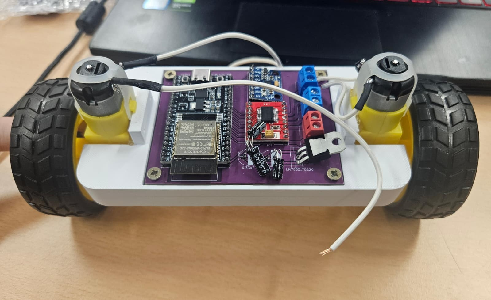
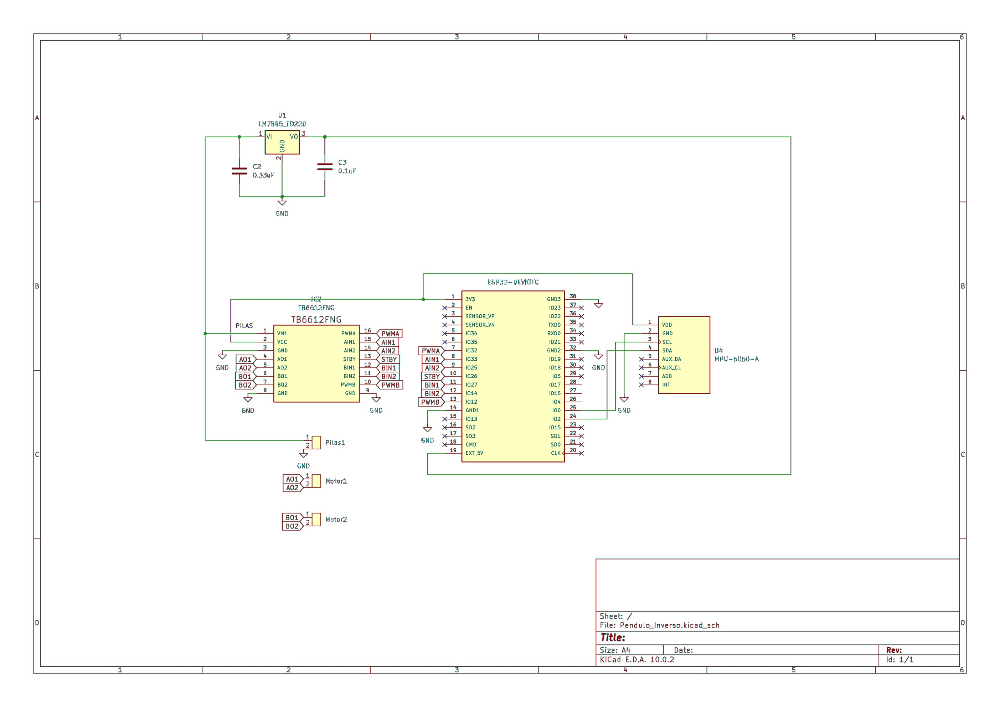
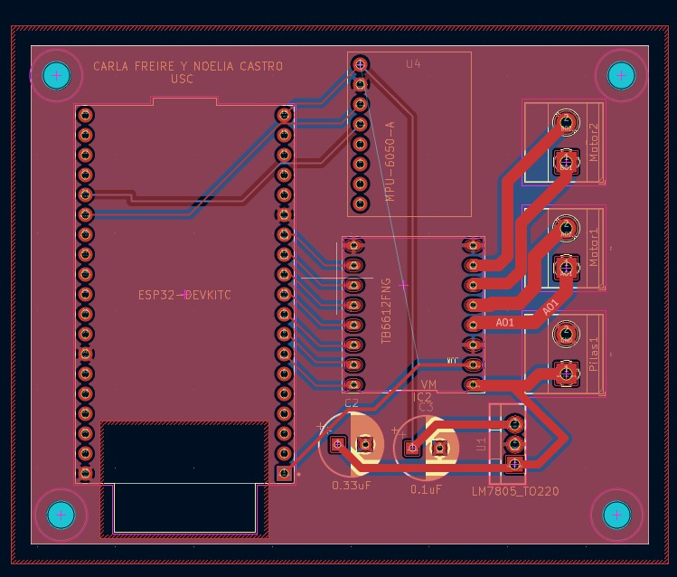
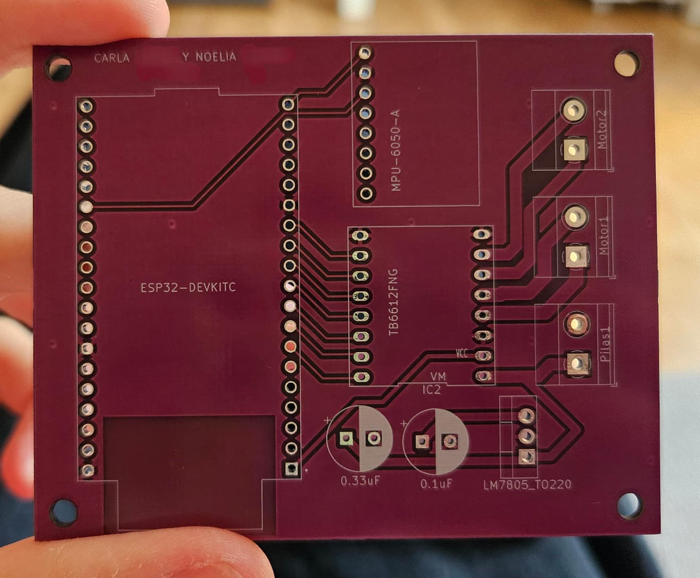
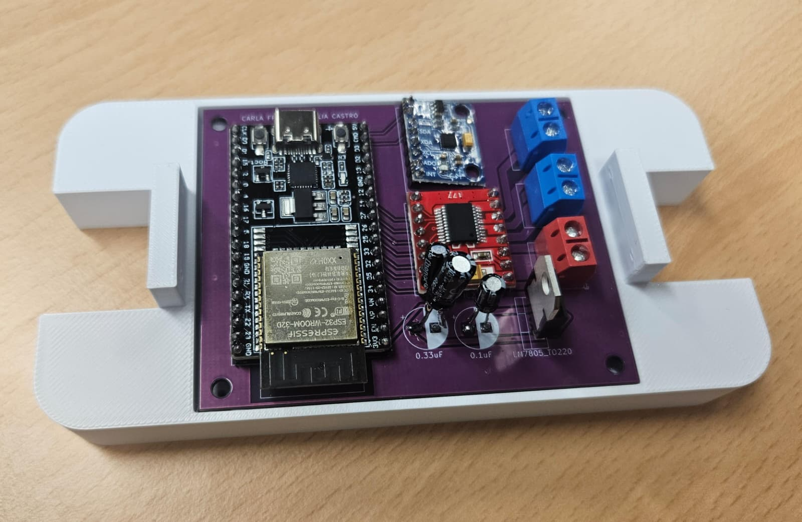

# Péndulo Invertido Autocontrolado

<p align="center">
  
</p>

<p align="center">
  <b>Robot autoequilibrado de dos ruedas con ESP32 y control PID</b><br>
  Grado en Robótica · Escola Politécnica Superior de Enxeñaría (EPSE) · USC<br>
  Asignatura: <a href="https://www.usc.gal/es/estudios/grados/ingenieria-arquitectura/grado-robotica-2a-edicion/20262027/teoria-control-19946-19042-2-105704">Teoría de control</a>
</p>

<div align="center">

[Web del proyecto](https://liln0e.github.io/Pendulo_Invertido/) · [Documentación técnica](documentacion.md) · [Costes (≈ 20,60 €)](costes.md) · [Fotos](fotos.md) · [Código](software/README.md)

</div>

---

## Descripción

Proyecto de la asignatura **Teoría de control** del Grado en Robótica.

Robot de dos ruedas que **se mantiene en equilibrio por sí solo**. Un sensor **MPU6050** mide la inclinación, un **filtro complementario** junta los datos del acelerómetro y del giroscopio, y un controlador **PID** que corre en una **ESP32** mueve los motores en tiempo real para devolver el robot a la vertical.

- **Electrónica:** PCB propia diseñada en KiCad y fabricada en JLCPCB.
- **Mecánica:** chasis modelado en Fusion 360 e impreso en 3D, con el centro de gravedad bajo.
- **Software:** tres versiones del controlador PID para comparar su estabilidad y cómo responden al ruido.
- **Coste:** unos **20,60 €** en materiales.

## Cómo funciona

```txt
MPU6050 → Estimación del ángulo → Filtro complementario → PID → TB6612FNG → Motores
   ↑                                                                          │
   └──────────────────────────── corrección de la inclinación ←───────────────┘
```

| Versión del código | Qué hace |
|---|---|
| [`PID_Basico.ino`](software/PID_Basico.ino) | PID discreto básico |
| [`PID_IIR.ino`](software/PID_IIR.ino) | PID escrito como filtro IIR |
| [`PID_Filtrado.ino`](software/PID_Filtrado.ino) | PID con el término derivativo filtrado, para reducir el ruido |

## Problemas y soluciones

- **Conexión errónea en la PCB:** cortamos la pista, unimos los puntos correctos con un hilo de cobre y lo aislamos con celo.
- **Pin de un motor quemado:** como las dos ruedas siempre reciben la misma señal, las conectamos las dos al pin que seguía funcionando y el robot siguió equilibrándose.

Más detalles en la [documentación técnica](documentacion.md#problemas-encontrados-y-soluciones).

## Hardware

| Componente | Función |
|---|---|
| ESP32 DevKitC | Microcontrolador principal |
| MPU6050 (GY-521) | IMU: acelerómetro y giroscopio |
| TB6612FNG | Driver de los motores |
| LM7805 | Regulador de tensión |
| 2 motores TT con ruedas | Tracción |
| Pila 3R12 de 4,5 V | Alimentación |

## Del diseño al robot

| Esquemático (KiCad) | Diseño de la PCB | PCB fabricada | Montaje |
|---|---|---|---|
|  |  |  |  |

## Estructura del repositorio

```txt
Pendulo_Invertido/
├── README.md
├── LICENSE
├── documentacion.md   → Explicación técnica completa
├── costes.md          → Desglose de materiales y coste
├── fotos.md           → Galería del proceso
├── _config.yml        → Configuración de la web (Jekyll + GitHub Pages)
├── assets/            → Fotos e imágenes del proceso
├── electronica/       → Esquemático y PCB en KiCad
├── mecanica/          → Modelo 3D (.3mf) y G-code del chasis
└── software/          → Código del controlador PID (Arduino / ESP32)
```

## Cómo usarlo

1. Instala en el Arduino IDE el soporte para placas **ESP32** y la librería **MPU6050** (`MPU6050.h`).
2. Abre el `.ino` que quieras de [`software/`](software/), selecciona la placa **ESP32 Dev Module** y súbelo.
3. Para ajustar el controlador, cambia `Kp`, `Ki` y `Kd` al principio del código (por defecto: `Kp = 18.0`, `Ki = 0.0`, `Kd = 0.8`). Con el monitor serie puedes ver lo que pasa mientras pruebas.

## Equipo

| Integrante |
|---|
| **Carla Freire Muíño** · [@carlafreeire](https://github.com/carlafreeire) |
| **Noelia Castro Rodríguez** · [@liln0e](https://github.com/liln0e) |

## Licencia

Proyecto académico publicado bajo la [licencia MIT](./LICENSE).
