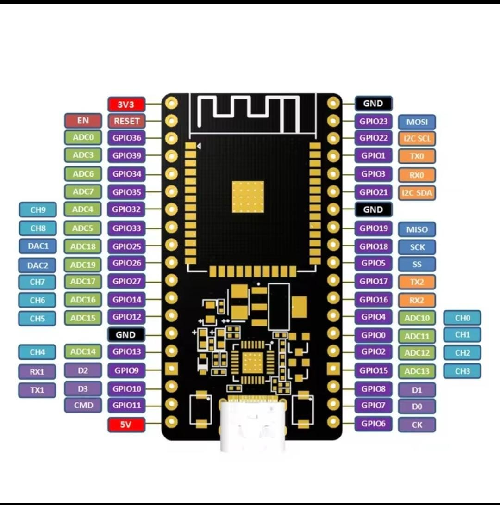

# Documentación técnica del proyecto

Este documento recoge la información técnica general del proyecto de **péndulo invertido autocontrolado (self-balancing robot)**, incluyendo la arquitectura del sistema, el diseño mecánico, la electrónica y el software implementado para el control del robot.

El objetivo principal del sistema es mantener el equilibrio de forma autónoma mediante un controlador **PID**, capaz de corregir la inclinación del robot actuando sobre los motores en tiempo real.

---

# Arquitectura general del sistema

El robot implementa un sistema de control en lazo cerrado compuesto por las siguientes etapas:

1. **Captura de inclinación** mediante una unidad IMU (**MPU6050**).
2. **Estimación del ángulo** utilizando acelerómetro y giroscopio.
3. **Filtrado de señal** mediante un **filtro complementario**.
4. **Cálculo de la acción de control PID**.
5. **Actuación sobre los motores** para recuperar la posición vertical.

El flujo simplificado del sistema es el siguiente:

```txt
MPU6050
    ↓
Estimación del ángulo
    ↓
Filtro complementario
    ↓
Control PID
    ↓
Driver TB6612FNG
    ↓
Motores
    ↓
Corrección de la inclinación
```

El sistema realiza un procesamiento continuo de los datos de inclinación y ajusta dinámicamente la velocidad de los motores para compensar perturbaciones y mantener la estabilidad.

---

# Diseño mecánico

La parte mecánica del robot se diseñó con el objetivo de obtener una estructura **compacta, ligera y estable**, favoreciendo un **centro de gravedad bajo** para mejorar el comportamiento dinámico del sistema.

El chasis fue modelado en **Fusion 360** y fabricado mediante **impresión 3D**, permitiendo adaptar la geometría a las necesidades específicas del proyecto y facilitar la integración de los componentes electrónicos.

Durante el desarrollo se realizaron distintas iteraciones del diseño para optimizar:

- Distribución del peso.
- Posicionamiento de la electrónica.
- Integración de motores y ruedas.
- Robustez estructural.
- Facilidad de ensamblaje.

El diseño final permite alojar de forma compacta todos los elementos del sistema, manteniendo un acceso sencillo a la electrónica y facilitando futuras modificaciones.

---

# Diseño electrónico

La electrónica del robot fue diseñada sobre una **PCB personalizada desarrollada en KiCad**, permitiendo integrar los distintos módulos del sistema en una única placa.

Los componentes principales utilizados son:

- **ESP32 DevKitC** → Unidad principal de control.
- **MPU6050** → Sensor IMU para estimación de inclinación.
- **TB6612FNG** → Driver de control de motores.
- **LM7805** → Regulación de tensión.
- Conectores de alimentación y motores.

El diseño electrónico se planteó con varios objetivos:

- Reducir el cableado del sistema.
- Mejorar la integración entre componentes.
- Facilitar el ensamblaje del robot.
- Incrementar la robustez del conjunto.

La PCB integra alimentación, control y conexiones de potencia necesarias para el funcionamiento autónomo del sistema.

---

# Diseño software

El software del robot se ejecuta sobre una **ESP32**, encargándose de procesar la información procedente del sensor y aplicar la lógica de control necesaria para mantener el equilibrio.

Las funcionalidades principales implementadas son:

- Lectura del sensor **MPU6050**.
- Estimación del ángulo de inclinación.
- Aplicación de un **filtro complementario**.
- Implementación del **control PID discreto**.
- Generación de señales de control para los motores.
- Ajuste y depuración mediante monitor serie.

Durante el desarrollo se implementaron tres versiones del controlador para comparar su comportamiento, su estabilidad y su sensibilidad al ruido:

- **Controlador original (PD con derivada filtrada):** la acción derivativa se obtiene directamente de la velocidad angular del giroscopio, suavizada con un filtro pasa-bajos. Es el que se usó en el robot, con `Kp = 10` y `Kd = 2`, ajustados de forma experimental.
- **PID directo:** calcula por separado las acciones proporcional, integral y derivativa. La derivada sale de la diferencia entre el error actual y el anterior.
- **PID IIR:** el mismo PID escrito como una ecuación incremental, con tres coeficientes (`A0`, `A1`, `A2`).

En los dos últimos, `Ki` empieza en 0, así que funcionan como un PD hasta que se le da otro valor. El bucle de control se ejecuta cada **5 ms** (200 Hz). Hay vídeos del robot con cada controlador en la [página de fotos y vídeos](fotos.md), y el detalle de cada código en [`software/`](software/README.md).

La lógica simplificada del software es:

```txt
Lectura IMU
    ↓
Estimación de inclinación
    ↓
Filtro complementario
    ↓
Cálculo PID
    ↓
Control de motores
    ↓
Corrección del equilibrio
```

---

# Problemas encontrados y soluciones

Como en cualquier prototipo, no todo salió bien a la primera. Estos son los dos problemas principales y cómo los resolvimos.

## Salidas del ESP32 mal asignadas en la PCB

Al montar la placa descubrimos, **comparando el diseño con el pinout del ESP32**, que habíamos asignado mal algunas salidas del ESP32 en la PCB.



Al contrastar la PCB (`Pendulo_Inverso.kicad_pcb`) con el pinout, vemos que **el fallo está en las dos líneas I2C del sensor**:

| Señal del MPU6050 | En la PCB va a | Pin I2C según el pinout (y el código final) |
|---|---|---|
| SCL | IO0 (pin 25 de la placa) | **GPIO22** (pin 36) |
| SDA | IO2 (pin 24 de la placa) | **GPIO21** (pin 33) |

El resto de conexiones son correctas: las siete señales del driver de motores (PWMA, AIN1, AIN2, STBY, BIN1, BIN2 y PWMB, en IO32, IO33, IO25, IO26, IO27, IO14 e IO12), la alimentación de 3,3 V y 5 V y las masas. La huella del ESP32 también sigue el mismo orden de pines que la placa real.

Además de no ser los pines I2C del pinout, **IO0 e IO2 son pines de arranque** (*strapping pins*) del ESP32. Su nivel al encenderse decide cómo arranca la placa. Las resistencias *pull-up* del módulo del MPU6050 conectadas a ellos pueden impedir programar el ESP32 o hacer que no arranque bien.

Como IO0/IO2 y GPIO21/GPIO22 están en la misma fila de pines del ESP32, lo arreglamos a mano sin fabricar otra placa:

1. **Cortamos las pistas** que iban a IO0 e IO2.
2. **Hicimos puentes con hilo de cobre** por la cara de abajo de la placa, a lo largo de esa fila, hasta GPIO22 y GPIO21.
3. **Cubrimos los hilos y las soldaduras con celo** para aislarlos y que no se movieran.

Con los puentes la placa funcionó correctamente. En el [vídeo del puente](assets/videos/puente_pcb.mp4) se ven los hilos bajo el celo. En una siguiente versión de la PCB habría que conectar SDA a GPIO21 y SCL a GPIO22 directamente en el diseño de KiCad.

## Pin del driver quemado

El robot funcionaba perfectamente, hasta que dejó de hacerlo: **un cortocircuito quemó una de las salidas del driver TB6612FNG**, la que movía una de las ruedas.

Lo pudimos arreglar gracias a cómo funciona un péndulo invertido. Las dos ruedas están en el mismo eje y, para corregir la inclinación, **siempre tienen que hacer lo mismo**: avanzar o retroceder a la vez y a la misma velocidad. El código ya lo hacía así, porque los dos motores reciben siempre la misma orden (`moverMotores(velocidad)`).

Así que **conectamos los dos motores a la salida del TB6612FNG que seguía funcionando** y el robot volvió a equilibrarse con normalidad. Así quedó el robot final: los dos motores en la misma salida del driver.

> **Lección aprendida:** como las dos ruedas siempre se mueven igual, para mantener el equilibrio basta con un solo canal del driver para los dos motores. Tener dos canales independientes sirve para que el robot pueda girar o para compensar diferencias entre los motores.

---

# Organización del repositorio

El proyecto se organiza en distintas carpetas para separar la documentación y facilitar el desarrollo:

```txt
Pendulo_Invertido/
│
├── README.md
├── LICENSE
├── costes.md
├── documentacion.md
│
├── assets/
├── electronica/
├── mecanica/
└── software/
```

Cada carpeta contiene información específica del proyecto:

- `electronica/` → Diseño PCB, esquemáticos y archivos de KiCad.
- `mecanica/` → Modelado 3D y archivos de fabricación.
- `software/` → Código fuente y pruebas del controlador.
- `assets/` → Recursos visuales del proyecto.
