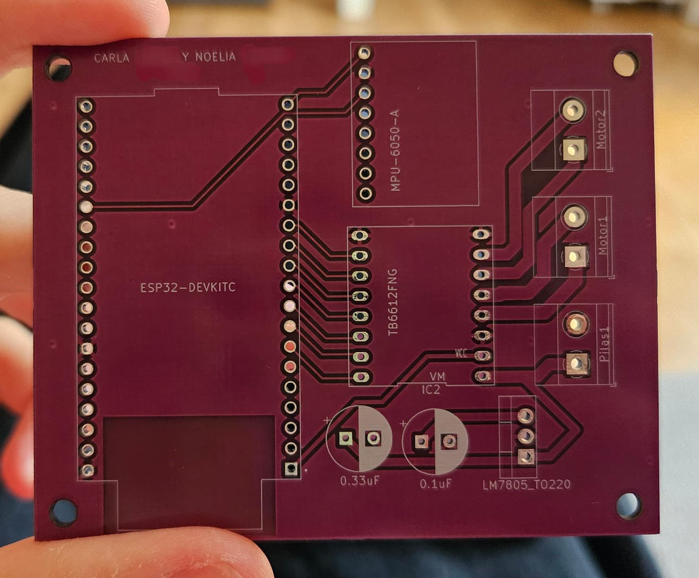

# Fotos y vídeos

Proceso de diseño, fabricación y montaje del péndulo invertido, y el robot funcionando con cada controlador.

---

## Vídeos del robot

| Vídeo | Qué se ve | Duración |
|---|---|---|
| ▶ [Controlador original (PD con derivada filtrada)](assets/videos/pd_derivada_filtrada.mp4) | El robot equilibrándose con el controlador que se usó al final | 31 s |
| ▶ [PID directo](assets/videos/pid_directo.mp4) | El robot con el PID discreto en forma directa | 32 s |
| ▶ [PID IIR](assets/videos/pid_iir.mp4) | El robot con el PID en forma incremental (IIR) | 25 s |
| ▶ [Estructura del robot](assets/videos/estructura_robot.mp4) | El chasis, los motores y la electrónica montada | 24 s |
| ▶ [Puente en la PCB](assets/videos/puente_pcb.mp4) | Los puentes de hilo de cobre que corrigen las líneas I2C, aislados con celo ([explicación](documentacion.md#salidas-del-esp32-mal-asignadas-en-la-pcb)) | 11 s |

---

## Esquemático electrónico

Esquemático hecho en **KiCad** con la **ESP32**, el driver de motores **TB6612FNG**, el sensor **MPU6050** y la etapa de alimentación con el **LM7805**.

---

## Pinout del ESP32

Pinout que usamos para comprobar el diseño. Gracias a él vimos que algunas salidas estaban mal asignadas en la PCB.

---

## Diseño de la PCB

Distribución de componentes y pistas en la PCB, diseñada para reducir el cableado y facilitar el montaje.

---

## PCB fabricada

Placa fabricada en **JLCPCB**, antes de soldar los componentes.

---

## Montaje de los componentes

La electrónica, ya integrada en el chasis impreso en 3D.

---

## Robot ensamblado

El robot terminado, con motores, ruedas y la electrónica de control.
