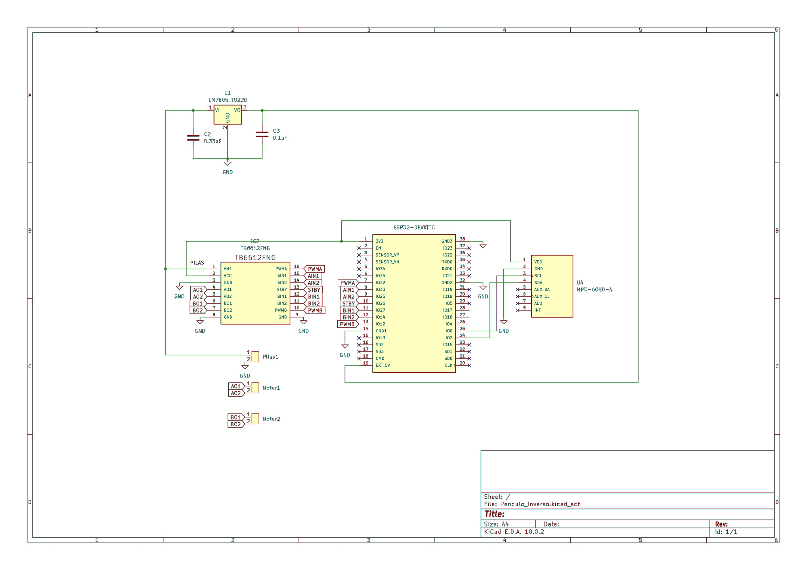
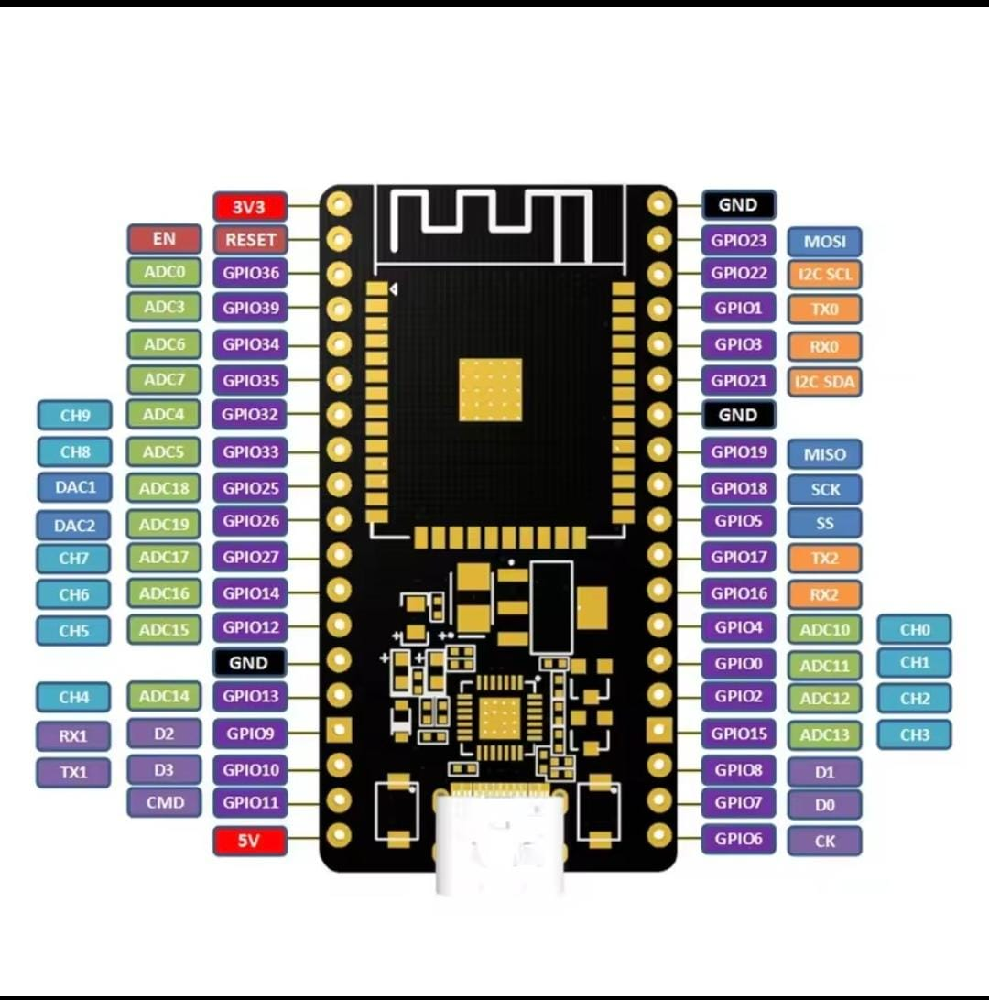
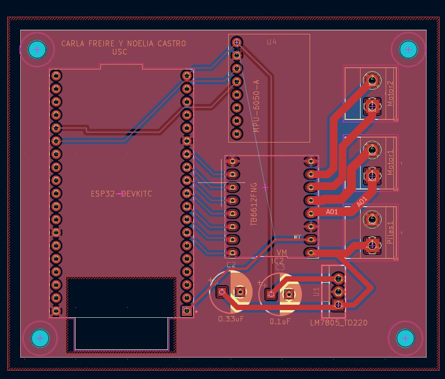
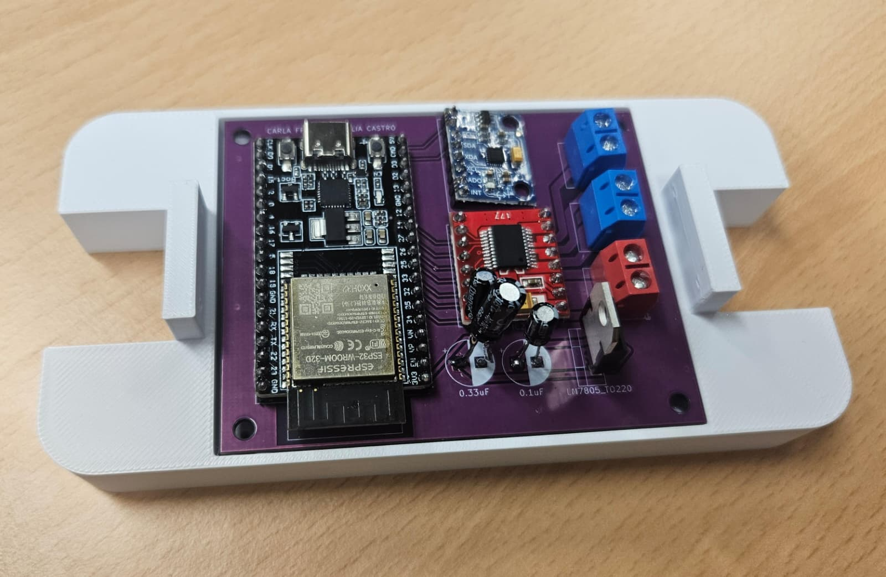
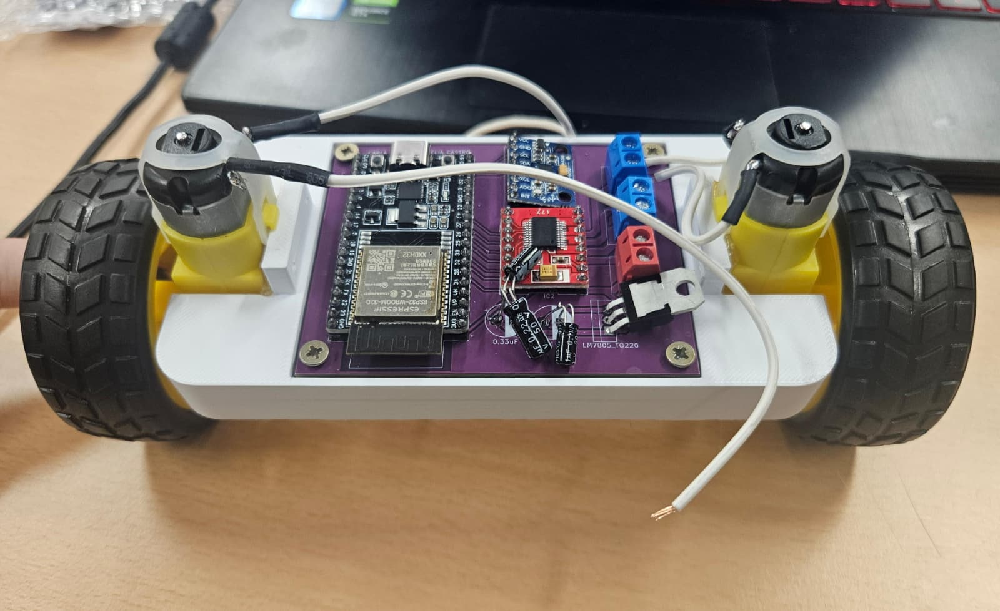

# Fotos y vídeos

Proceso de diseño, fabricación y montaje del péndulo invertido, y el robot funcionando con cada controlador.

---

## Vídeos del robot

### Controlador original: PD con derivada filtrada

<video src="assets/videos/pd_derivada_filtrada.mp4" controls preload="metadata" width="100%"></video>

[Descargar vídeo](assets/videos/pd_derivada_filtrada.mp4)

### PID directo

<video src="assets/videos/pid_directo.mp4" controls preload="metadata" width="100%"></video>

[Descargar vídeo](assets/videos/pid_directo.mp4)

### PID IIR

<video src="assets/videos/pid_iir.mp4" controls preload="metadata" width="100%"></video>

[Descargar vídeo](assets/videos/pid_iir.mp4)

### Estructura del robot

<video src="assets/videos/estructura_robot.mp4" controls preload="metadata" width="100%"></video>

[Descargar vídeo](assets/videos/estructura_robot.mp4)

### Puente en la PCB

<video src="assets/videos/puente_pcb.mp4" controls preload="metadata" width="100%"></video>

[Descargar vídeo](assets/videos/puente_pcb.mp4)

Arreglo de las salidas del ESP32 mal asignadas: pista cortada y puente con hilo de cobre, aislado con celo. Se explica en la [documentación técnica](documentacion.md#salidas-del-esp32-mal-asignadas-en-la-pcb).

---

## Esquemático electrónico

Esquemático hecho en **KiCad** con la **ESP32**, el driver de motores **TB6612FNG**, el sensor **MPU6050** y la etapa de alimentación con el **LM7805**.

---

## Pinout del ESP32

Pinout que usamos para comprobar el diseño. Gracias a él vimos que algunas salidas estaban mal asignadas en la PCB.

---

## Diseño de la PCB

Distribución de componentes y pistas en la PCB, diseñada para reducir el cableado y facilitar el montaje.

---

## PCB fabricada

Placa fabricada en **JLCPCB**, antes de soldar los componentes.

---

## Montaje de los componentes

La electrónica, ya integrada en el chasis impreso en 3D.

---

## Robot ensamblado

El robot terminado, con motores, ruedas y la electrónica de control.
